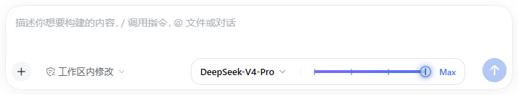
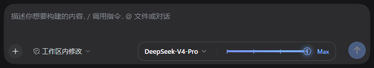
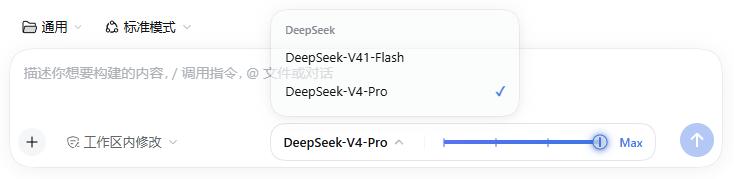

<h1 align="center">dsh-composer-plus</h1>

<p align="center">One plugin, four things: <b>model picker</b> + <b>draggable reasoning-effort rail</b> + <b>DeepSeek account hider</b> + <b>right-click file actions</b>.</p>

<p align="center"></p>

<p align="center"><a href="README.zh.md">中文</a> | English</p>

## What it is

`dsh-composer-plus` is a pure front-end plugin for the [DeepSeek Harness](https://github.com/deepseek-ai/deepseek-harness) (dsh) **web client**. It folds the composer's right-hand controls into one pill:

| Feature | What it does |
| --- | --- |
| **Model picker** | Click the model name to get a provider-grouped list (no submenu). A pick applies immediately. |
| **Effort rail (drag bar)** | A notched slider: click, drag, or use `←`/`→`/`Home`/`End`. Levels come from each model's own `reasoningEfforts`; the top level gets a gradient sweep and halo. |
| **Hide DeepSeek account** | The bundle patch disables the official account entry (sidebar account menu, account settings page, credential onboarding), and the custom model menu filters the `deepseek-account` channel. |
| **File context menu** | Right-click a changed-files card, a delivered file card, a file-tree row, or a rendered file-path link: open it in the sidebar or show it in Finder (Explorer / the default file manager on other platforms). |
| **Theme-aware** | Every color binds to `--dsw-alias-*` theme variables, so light/dark and third-party skins stay readable. |
| **Zero intrusion** | A modular bundle: no core changes, nothing written outside the profile, clean removal. |

The file menu reuses shipped capabilities: the target's own click, the `shell.overlay` / `Menu` / `Toast` primitives, and the Session Remote's `openWorkspacePath({ action: 'reveal' })` (the Host runs `open -R` on macOS), so it adds no host route.

<p align="center"></p>
<p align="center"></p>

## Compatibility

- dsh **0.1.5+** (the `ctx.modelDirectories` / `session/selectModel` generation) and a **web client** (`dsh web`, or the web UI inside the desktop app).
- End-to-end tested on dsh **0.2.1-rc.2**: model switching, drag + keyboard effort changes, light/dark themes, no account entry in Settings, and the file context menu.
- The rail only appears for models that declare reasoning levels; other models show the picker alone.
- The plugin draws into the composer's `conversation.input.right` seat and tucks the native model trigger away. If a future dsh changes the composer DOM and the native trigger is not hidden, please open an issue.
- The file menu recognizes dsh's DOM contracts (`data-changed-files`, `data-presented-file`, `data-files-path/entry`, and path-link buttons carrying a `title`). If a later dsh renames one, the menu stays quiet instead of hijacking unrelated right-clicks.

## Install

### Web profile (`dsh web`)

```sh
# straight from GitHub — no npm account needed
dsh plugin --profile web add github:WuweiRE/dsh-composer-plus
```

Or clone and install the local directory:

```sh
git clone https://github.com/WuweiRE/dsh-composer-plus.git
dsh plugin --profile web add ./dsh-composer-plus
```

Restart `dsh web` (or `dsh --profile web`) once and refresh the page. Later client-only updates usually need just a refresh.

### Desktop app

The desktop profile is managed by the Electron app (`dsh plugin --profile desktop` is refused). Install this bundle from the app's **Plugins** page (GitHub repo or a local directory), then restart the app. If your build has no such entry, validate on a web profile first and point the app at that profile.

> The plugin participates in profile composition, so install/remove needs one app restart; CSS/client-only changes only need a refresh.

## Configuration

All three switches are on by default and live in the bundle's own `cordis.patch.yml`:

```yaml
- insert:
    - id: ui-composer-plus
      name: dsh-composer-plus
      config:
        hideAccount: true        # account menu / account settings page / credential onboarding + leftover rows
        hideAccountModels: true  # filter the deepseek-account channel from the custom model menu
        fileActions: true         # right-click file menu (open in sidebar / show in Finder)
```

To bring the official account UI back, override the row in **your profile's `cordis.patch.yml`** and delete these two patches, which are what actually close the account page:

```yaml
- id: ui-settings-account
  disabled: true
- id: ui-settings-models
  name: '@deepseek-ai/dsh-client-ui-settings-models'
  config:
    credentialOnboarding: false
```

## Uninstall

```sh
dsh plugin --profile web remove dsh-composer-plus
```

Then restart `dsh web` / the app. The plugin stores no runtime data; the last selected effort stays in dsh's own session state.

## Layout

```text
dsh-composer-plus/
├─ package.json          # bundle + web client manifest (immediately / inject)
├─ cordis.patch.yml      # account hider patches + plugin row
├─ lib/index.js          # host half: publishes options as window.__DSH_COMPOSER_PLUS__
├─ lib/client.js         # browser half: pill, model menu, rail, account-row hider, file context menu
├─ locale/{zh,en}.json   # plugin-manager title/description
├─ icon.svg              # plugin icon
├─ test/context-menu.smoke.mjs  # Node smoke test for the file context menu (npm test)
└─ docs/*.png            # README screenshots
```

There is no build step: `lib/client.js` is a browser-executed `window.__ModuleLoader__.load({...})` factory and React comes from the dsh module table.

## Known limits

- Account hiding is **patch-layer disable + client-side fallback**: another plugin that re-adds account UI can override it; disable that plugin first.
- The account-model filter only affects this plugin's menu; the native `/model` popup is still dsh's (use it to pick an account model temporarily).
- Web client only; headless/TUI profiles never render the composer.
- The file menu only acts on file elements the UI already renders; a plain-text path in a message that is neither a link nor a file card gets no menu.

## License

[MIT](./LICENSE). Third-party credits: [THIRD_PARTY_NOTICES.md](./THIRD_PARTY_NOTICES.md).
